# Zero-Setup AI Mock API Server

Describe a REST API in plain language → get a validated, running mock API with realistic data, CRUD state, pagination, filtering, sorting, OpenAPI export and a browser console to test it. **No database and no AI key are needed to start.**

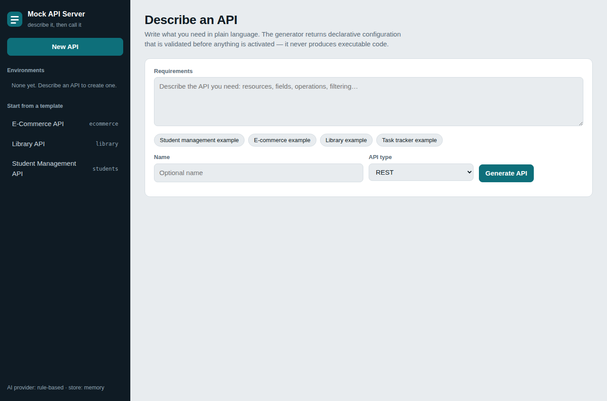
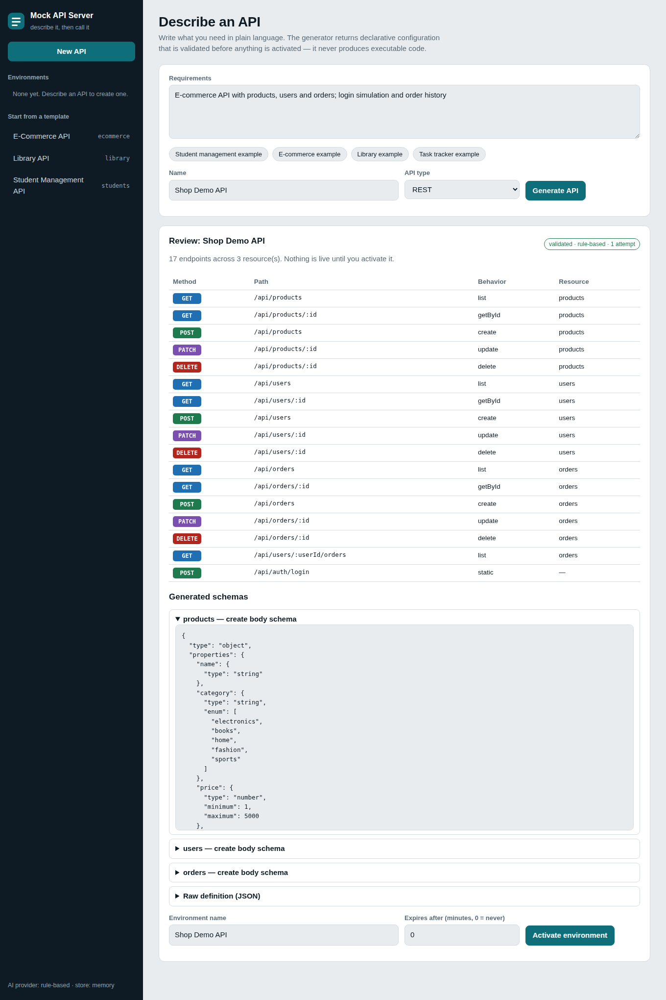
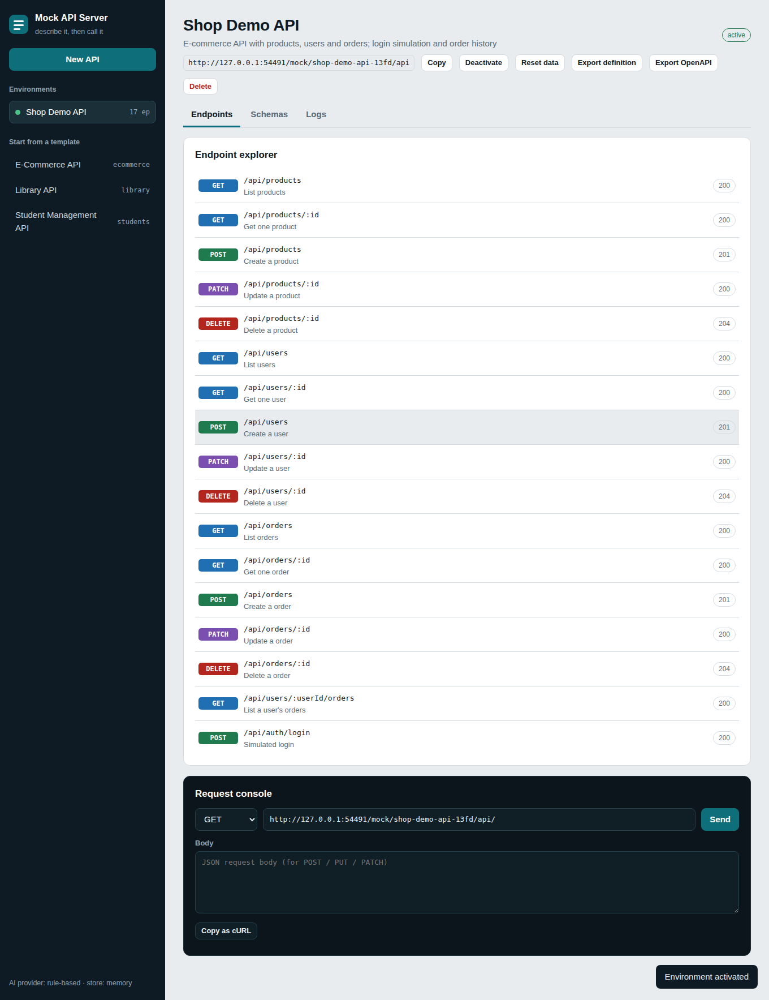
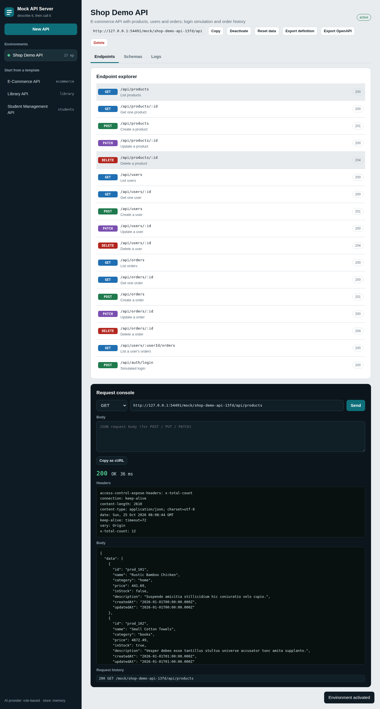
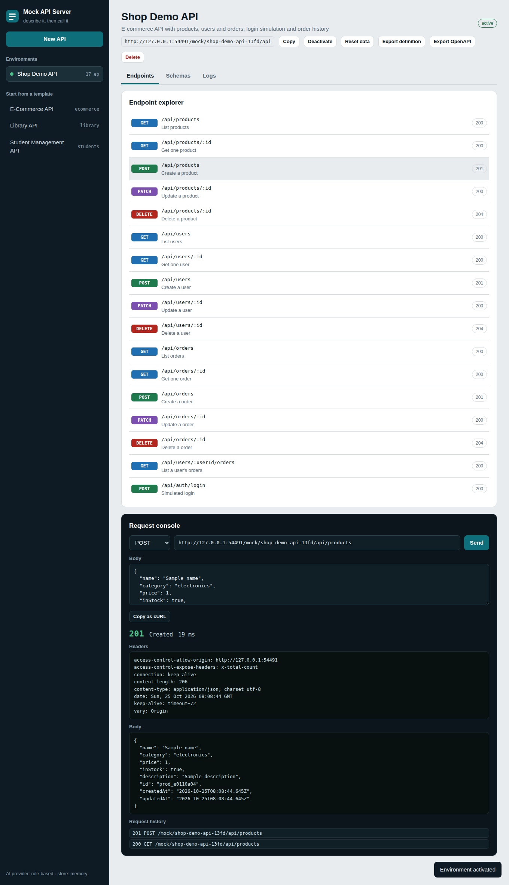
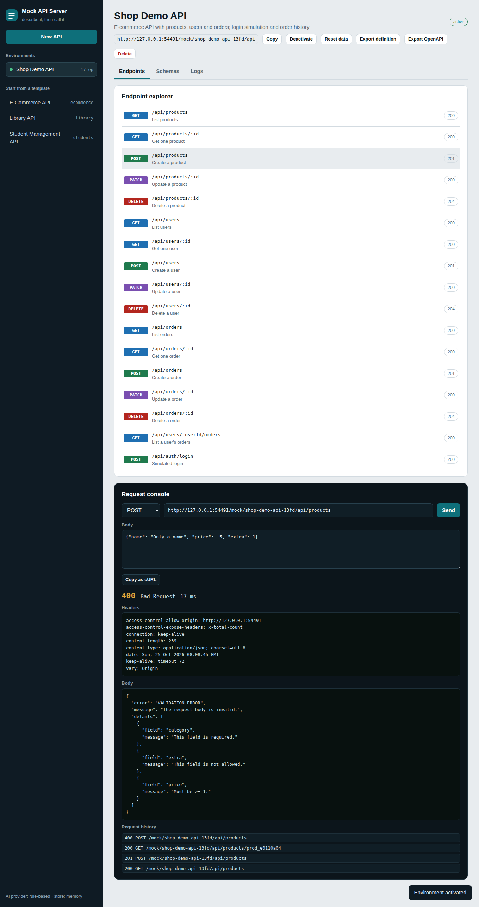
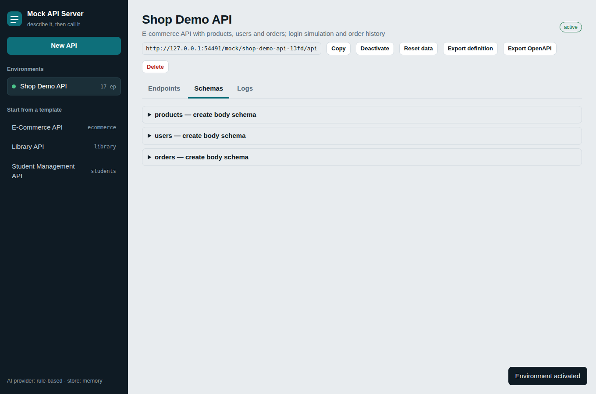
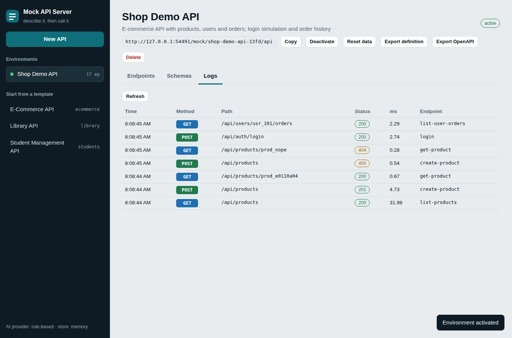
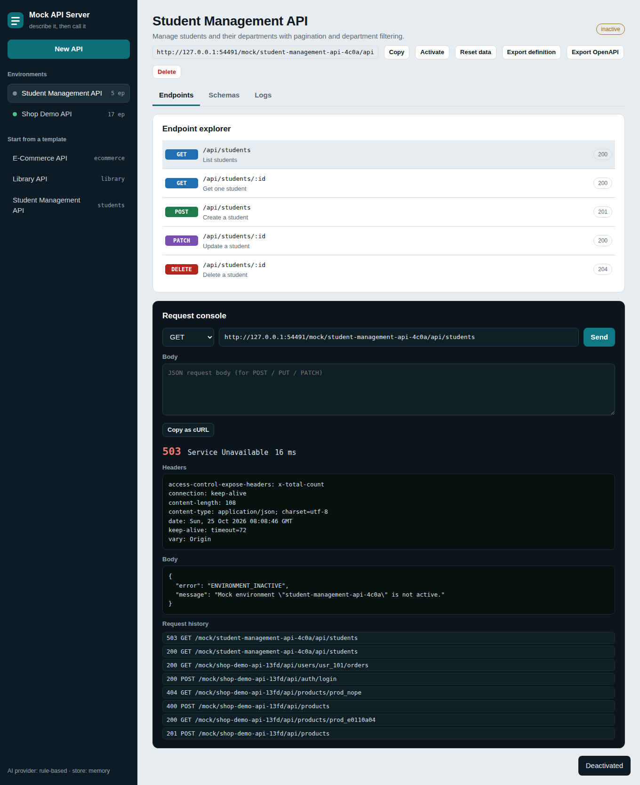
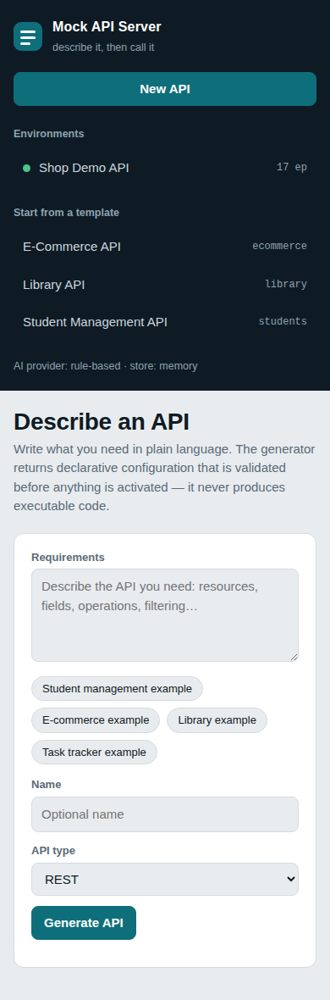
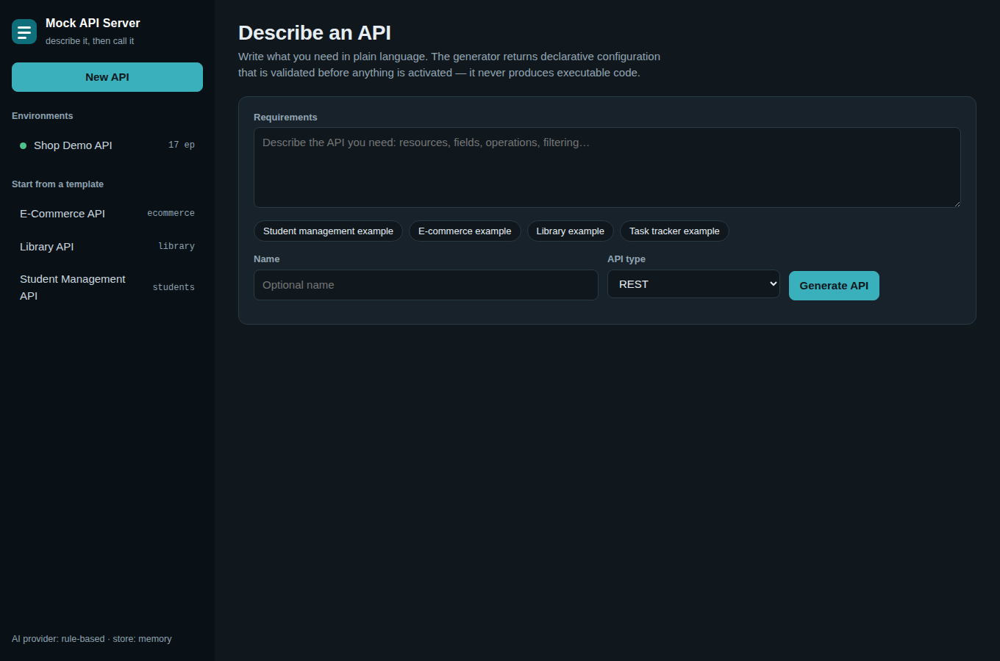

## Quick start

```bash
npm install
npm run build
npm start            # http://127.0.0.1:4000
```

Open http://127.0.0.1:4000, click a template (e.g. *Student Management API*) or describe an API and press **Generate API → Activate environment**. Development mode with reload: `npm run dev`.

Or from the command line:

```bash
curl -X POST localhost:4000/api/projects -H 'content-type: application/json' \
  -d '{"id":"student-demo","name":"Student Demo","fixture":"students"}'
curl 'localhost:4000/mock/student-demo/api/students?department=Mechanical&sort=name&limit=5'
curl -X POST localhost:4000/mock/student-demo/api/students -H 'content-type: application/json' \
  -d '{"name":"Rohan Deshmukh","email":"rohan@example.com","department":"Civil","year":3}'
```

## How it works

```
Prompt → AI provider → JSON definition → validator ──✗→ rejected (422, nothing activated)
                                            │✓
                                  project + seeded data (store)
                                            │
        /mock/<project>/<basePath>/… → route match → request validation → allowlisted handler → JSON
```

The key design rule: **AI output is configuration, never code.** A definition only *names* one of six built-in behaviors (`list`, `getById`, `create`, `update`, `delete`, `static`). Unknown keys, unknown behaviors, `$ref`s, bad routes and oversized definitions are rejected before anything becomes active. Nothing is ever `eval`'d.

### AI generation
| Mode | When | Notes |
|---|---|---|
| Anthropic | `ANTHROPIC_API_KEY` set (or `AI_PROVIDER=anthropic`) | Output is validated; on failure it is re-prompted once with the validator's errors. Key stays server-side. |
| Rule-based (offline) | default | Deterministic, template-based generator for common resources (students, products, users, orders, books, …). Not a language model; use it for demos and tests. |

Swap providers by implementing the 1-method `AiProvider` interface (`src/modules/ai/aiClient.ts`).

## Mock endpoint behaviour

| Feature | Details |
|---|---|
| Status codes | 200/201/204, 400 (validation / bad query), 404, 405 (+`Allow`), 409 (limits), 410 (expired), 413, 415, 429, 503 (inactive), 500 |
| Errors | `{"error":"VALIDATION_ERROR","message":"…","details":[{"field":"email","message":"This field is required."}]}` |
| List queries | `page`, `limit` (max 100), `sort`, `order`, `q`, `<field>=value`, `<field>_min` / `<field>_max` |
| Response | `{"data":[…],"pagination":{"page","limit","total","totalPages"}}` + `X-Total-Count` |
| Data | Seeded with Faker (deterministic per `seed`), validated against the resource schema. All data is fictional. |
| State | Writes persist for the life of the environment; **Reset data** restores the seed. |

## Management API

`GET /health` · `POST /api/generate` · `GET /api/fixtures` · `POST|GET /api/projects` · `GET|PUT|DELETE /api/projects/:id` · `GET …/endpoints` · `GET …/schemas` · `POST …/activate|deactivate|reset` · `GET …/logs` · `GET|POST …/export` (`format`: `definition` | `openapi`). Details in [docs/api-reference.md](docs/api-reference.md). Set `ADMIN_TOKEN` to require `Authorization: Bearer <token>` on `/api/*`.

## Testing

```bash
npm test                 # 268 unit + integration tests (Vitest, no network, no API key)
npm run typecheck        # strict TypeScript
npm run build && python3 e2e/dashboard.e2e.py   # 19 real-browser checks + screenshots
```
The e2e script needs `pip install playwright && playwright install chromium`. See [docs/TEST-REPORT.md](docs/TEST-REPORT.md) for the last recorded run.

## Configuration
Copy `.env.example`. Everything is optional. Notable: `STORE=redis` + `REDIS_URL` (optional shared state), `DEFAULT_TTL_MINUTES`, rate limits, size limits.

## Project layout
```
apps/server/src   app, config, routes/, plugins/, modules/{ai,generator,runtime,validation,data,store,projects}
apps/server/fixtures   students / ecommerce / library API definitions
apps/server/tests      unit/ and integration/
apps/web/public        static dashboard (no build step)
e2e/                   Playwright browser test
docs/                  architecture, api-reference, security, setup, deployment, test report
```
